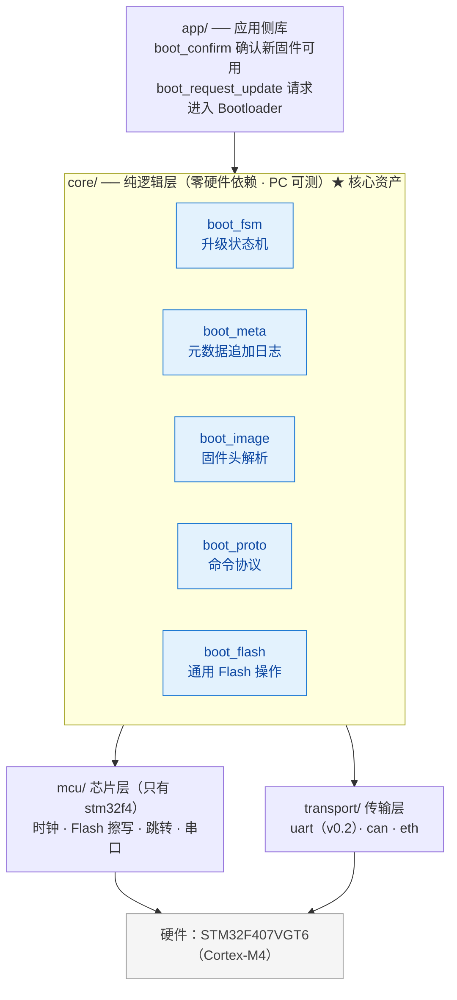
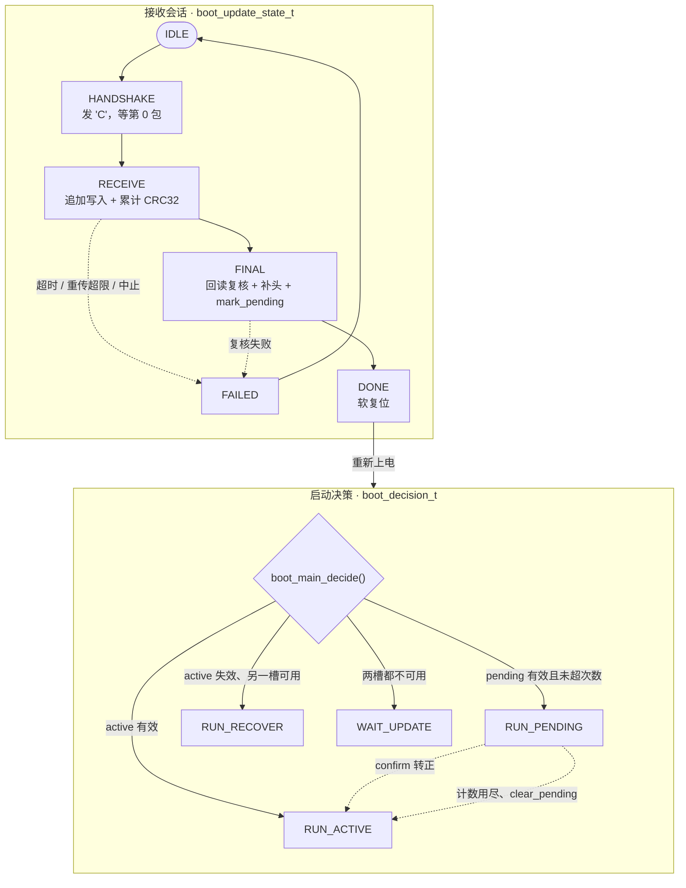

# 🏗️ 01 架构设计

 

> 📚 **系列导航**：[00 规划](00-project-plan.md) · [01 架构](01-architecture.md) · [02 Git](02-git-and-github.md) · [03 风格](03-code-style.md) · [04 实现](04-boot-implementation.md) · [05 对标](05-bootloader-landscape.md)

> [!NOTE]
> 本文是项目的技术图纸，回答"应该怎么做"。其中分层架构（§2–§4）与 §5.3 的芯片层布局结构体是**目标形态**（随规划版本逐步落地，当前实际布局为 `Keil_OTA_Boot/` + `Keil_App/` + `Common/ota/`，见 [04 §0 代码地图](04-boot-implementation.md)）；§5.1/§5.2 的分区表、§6 的镜像头与元数据、§7 的状态机已按当前实现对齐。功能范围与版本规划见 [00-project-plan.md](00-project-plan.md)。

---

## ⚖️ 1. 设计铁律

这三条是硬约束，违反即视为架构错误，必须回退重构。

| # | 铁律 | 含义 |
|---|---|---|
| R-1 | **F407 跑通前不写任何抽象层** | 抽象是从跑通的代码里"抠"出来的结果，不是设计出来的前提。`core/` 在 v0.3.0 之前根本不存在 |
| R-2 | **硬件相关代码只允许出现在 `code/mcu/stm32f4/`** | 一旦 `core/` 里出现寄存器、HAL 或平台宏，说明分层错了——重构分层，而不是打补丁 |
| R-3 | **`core/` 零硬件依赖，可在 PC 上编译运行** | 这是"掉电安全可以被自动化验证"的前提：拔电测试不能只靠手拔 |

配套验证手段：`code/tests/mock/` 把 Flash 模拟成一段 RAM 数组（且**照抄 F4 的不均 sector 尺寸表**），`core/` 的所有逻辑都在这上面跑单元测试。

---

## 🧱 2. 分层架构



**依赖方向严格单向**：`core` 依赖 `mcu` 与 `transport` 的**接口**，芯片层实现依赖硬件。

`core` 存在的理由只有一个：**让 "任意时刻断电都能恢复" 这条不变式可以被自动化验证**。把逻辑锁死在真板中断电重试，永远拿不到可信数据。所以这里的"分层"不是为了可移植，而是为了可测试——这是本项目放弃多芯片支持后，仍然保留 `core/` 的原因。

---

## 📁 3. 目录结构

仓库根目录只有文档与构建文件，全部源代码归入 `code/`。

```
.
├── README.md
├── LICENSE                   Apache-2.0
├── CHANGELOG.md
├── .gitignore
├── CMakeLists.txt            顶层构建（v0.1.0 引入）
│
├── Drivers/                  ST 官方代码（vendored 最小子集，非本项目源码）
│   ├── CMSIS/                内核与设备头文件、启动文件、system_stm32f4xx.c
│   └── STM32F4xx_HAL_Driver/ 只拷贝用到的模块（rcc / uart / gpio / ...）
│
├── code/                     全部源代码
│   │
│   ├── core/                 纯 C，零硬件依赖（v0.3.0 引入）
│   │   ├── boot_fsm.c/.h     升级状态机
│   │   ├── boot_meta.c/.h    元数据追加日志读写
│   │   ├── boot_image.c/.h   固件头解析与校验
│   │   ├── boot_flash.c/.h   通用 Flash 操作（擦除单元感知）
│   │   ├── boot_proto.c/.h   YMODEM + 命令协议
│   │   └── boot_cfg.h        全局编译期配置
│   │
│   ├── mcu/                  芯片层：唯一允许出现寄存器的目录
│   │   ├── mcu.h             接口定义（core 与芯片层之间）
│   │   └── stm32f4/          时钟 · Flash 擦写 · 跳转 · 串口 · 启动汇编 · 链接脚本
│   │
│   ├── transport/            传输层
│   │   ├── transport.h       接口定义
│   │   └── uart/             串口实现
│   │
│   ├── app/                  App 侧链接的库
│   │   ├── boot_client.c/.h  确认 / 请求升级
│   │   └── boot_client_cfg.h
│   │
│   ├── bsp/                  示例工程
│   │   └── stm32f407_demo/   完整示例工程（Boot + App + fake_app）
│   │
│   ├── tools/                固件打包与上位机
│   │   ├── firmware_pack.py  固件打包（追加头部）
│   │   └── ota_tool/         上位机升级工具
│   │
│   └── tests/                PC 端单元测试
│       ├── mock/             模拟芯片层（RAM 当 Flash + 掉电注入）
│       ├── test_image.c
│       ├── test_meta.c
│       ├── test_meta_powerloss.c
│       └── test_fsm.c
│
├── docs/
│   ├── 00-project-plan.md    项目规划（定位 / 功能清单 / 里程碑）
│   ├── 01-architecture.md    本文档
│   ├── 02-git-and-github.md  开发与协作指南
│   └── power-loss-design.md  掉电安全设计
│
└── .github/
    ├── workflows/ci.yml      编译 + 单元测试
    └── ISSUE_TEMPLATE/
```

> [!NOTE]
> `Drivers/` 采用 vendored 最小子集而不是引入 CubeF4 子模块：整个 CubeF4 仓库数百 MB，clone 即劝退；最小子集可保证 CI 可复现。该目录是第三方代码，不受 R-2 约束——R-2 管的是**本项目**代码的组织方式。
>
> `CODE_OF_CONDUCT.md`、`CONTRIBUTING.md`、Issue/PR 模板在 GitHub 仓库公开后补充。

---

## 🔌 4. 芯片层接口：`code/mcu/mcu.h`

这个头文件从 v0.3.0 起存在（见 R-1）。它**不是为了将来移植到别的芯片**（N-05 已经否掉了这条路），唯一目的是让 `core/` 能在 PC 上被编译和测试：

- 目标板实现：`code/mcu/stm32f4/`，直接操作 F4 寄存器；
- PC 侧实现：`code/tests/mock/`，把 Flash 模拟成一段 RAM 数组，并提供"第 N 次写之后掉电"的注入开关。

所以这里不存在"可移植性"的承诺，只有一条能被检验的要求：**同一份 `core/` 逻辑，在真板与 PC 上给出同样的行为。**

```c
#ifndef BOOT_MCU_H
#define BOOT_MCU_H

#include <stdint.h>
#include <stddef.h>

/* 标记函数需常驻 RAM 执行（F4 擦写 Flash 时的硬性要求，见第 8 节） */
#if defined(BOOT_MCU_RAMFUNC)
#define BOOT_RAMFUNC  BOOT_MCU_RAMFUNC
#else
#define BOOT_RAMFUNC
#endif

typedef struct {
    uint32_t start;          /* 区域起始地址 */
    uint32_t size;           /* 区域大小（字节） */
} boot_region_t;

typedef struct {
    /* ---- 分区布局（真板与 mock 各一份，数值必须一致） ---- */
    boot_region_t boot;         /* Bootloader 自身区域 */
    boot_region_t meta;         /* 元数据区域（扇区内追加日志） */
    boot_region_t slot[2];      /* Slot A / Slot B */

    /* ---- Flash 基本能力 ---- */
    int      (*init)(void);
    int      (*deinit)(void);

    /* 返回 addr 所在擦除单元的起始地址与大小。
       F4 的擦除单元是 sector，且 12 个 sector 大小不均（16/64/128 KB），
       因此必须用函数在运行时查询 —— 任何地方都不允许写死 sector 尺寸。 */
    uint32_t (*erase_unit_base)(uint32_t addr);
    uint32_t (*erase_unit_size)(uint32_t addr);

    int      (*erase)(uint32_t addr, uint32_t len);   /* len 必须为擦除单元整数倍 */
    int      (*write)(uint32_t addr, const void *buf, uint32_t len);
    int      (*read)(uint32_t addr, void *buf, uint32_t len);

    /* ---- 启动控制 ---- */
    uint32_t (*app_entry_get)(uint32_t slot_base);    /* 由向量表取 Reset_Handler */
    uint32_t (*app_stack_get)(uint32_t slot_base);    /* 由向量表取初始 MSP */
    void     (*periph_deinit)(void);                  /* 关外设、清 NVIC、停 SysTick */
    void     (*jump)(uint32_t entry, uint32_t stack);
    void     (*system_reset)(void);

    /* ---- 升级请求标志（F4 用 .noinit SRAM 邮箱，实现见 04-boot-implementation.md §1） ---- */
    void     (*mailbox_set)(uint32_t flag);
    uint32_t (*mailbox_get)(void);
    void     (*mailbox_clear)(void);
} boot_mcu_t;

/* 真板与 mock 各提供一份实现 */
const boot_mcu_t *boot_mcu_get(void);

#endif /* BOOT_MCU_H */
```

### 设计要点说明

- **`erase_unit_base/size` 必须是函数**：F4 的 sector 大小不均，`core` 只使用"擦除单元"这个概念，任何地方都不允许出现 `FLASH_SECTOR_SIZE` 这类平台宏。
- **mock 必须照抄真实的 sector 尺寸表**，而不是一段等大的假 Flash——否则测不出"跨 sector 边界被擦坏"这类真实缺陷，而元数据日志的整扇区回收恰好依赖这个边界。
- **`erase` 的长度语义按擦除单元处理**：`core` 负责把请求对齐到擦除单元边界，芯片层负责实际擦除。
- **`app_entry_get/app_stack_get` 而非直接读地址**：向量表取值这一步由芯片层封装，`core` 不假设 Cortex-M4 之外的内核布局。
- **`mailbox_*` 抽出为接口**：真板用 `.noinit` SRAM 邮箱（`Boot/Mailbox/boot_mailbox.c`），mock 用一个静态变量，差异在此处吸收。

---

## 📦 5. Flash 分区布局

### 5.1 STM32F407 物理 sector 布局

F407VGT6 的 1 MB Flash 由 12 个 sector 组成，**大小不均**：

| Sector | 起始地址 | 大小 |
|---|---|---|
| 0 | 0x08000000 | 16 KB |
| 1 | 0x08004000 | 16 KB |
| 2 | 0x08008000 | 16 KB |
| 3 | 0x0800C000 | 16 KB |
| 4 | 0x08010000 | 64 KB |
| 5 – 11 | 0x08020000 起 | 各 128 KB |

擦除单元是**整个 sector**——这一条事实决定了下面所有取舍。

### 5.2 项目布局

| 区域 | 起止地址 | 大小 | 占用 sector |
|---|---|---|---|
| Bootloader | 0x08000000 – 0x0800FFFF | 64 KB | 0 – 3 |
| 参数数据区（NVS） | 0x08010000 – 0x0801FFFF | 64 KB | 4 |
| Slot A | 0x08020000 – 0x0807FFFF | 384 KB | 5 – 7 |
| Slot B | 0x08080000 – 0x080DFFFF | 384 KB | 8 – 10 |
| Metadata | 0x080E0000 – 0x080FFFFF | 128 KB | 11 |

三条推导理由：

1. **Boot 需要 64 KB 时，sector 0–3 必须整块给它**；sector 4 是唯一的 64 KB 扇区，继续作参数数据区（NVS），两个槽仍从 sector 5 的 128 KB 边界开始。
2. **A/B 两槽等大（各 384 KB）**，打包工具只需要一条容量规则。sector 5–11 共 7 个 128 KB 扇区，是奇数，无法等分成两个 448 KB：448 KB 会切在 sector 8 中间，两槽共用一个擦除单元。384 + 384 之后必然剩下 sector 11，正好留给 Metadata。
3. **Metadata 改为 sector 11 内的追加日志**。sector 11 只有一个擦除单元，放不下两份互相独立的副本；日志按 32 字节一条顺序追加，写满整个扇区才擦除回收一次。追加写本身掉电安全，唯一窗口是写满后整扇区擦除到新记录写完之间——此时设备以默认值停在升级模式，可恢复但不会自动启动 App。

> [!CAUTION]
> **不要为了"省那 64 KB"把 Slot B 扩到 512 KB。** 两槽不等大意味着打包校验、元数据格式、上位机三处都要处理两套容量，而可用的最大镜像仍受较小槽限制——这是典型的用复杂度换不到空间。

### 5.3 布局以什么形式存在

真板与 mock 各提供一份布局结构体，**数值必须逐字一致**（不一致等于测了个假的）：

```c
/* code/mcu/stm32f4/mcu_stm32f4.c */
static const boot_mcu_t s_mcu_f407 = {
    .boot = { 0x08000000, 64  * 1024 },
    .meta = { 0x080E0000, 128 * 1024 },   /* 追加日志，独占 sector 11 */
    .slot = {
        { 0x08020000, 384 * 1024 },       /* Slot A */
        { 0x08080000, 384 * 1024 },       /* Slot B */
    },
    .init = f4_flash_init,
    /* ... */
};
```

---

## 🧬 6. 数据格式

> [!NOTE]
> 本节结构以代码的实际定义为准（单一事实来源）：镜像头见 `Common/ota/ota_image.h`（`ota_image_header_t`），元数据见 `Keil_OTA_Boot/Boot/Storage/Inc/boot_metadata.h`（`boot_metadata_t`），启动决策类型见 `Keil_OTA_Boot/Boot/Config/boot_types.h`（`boot_decision_t` / `boot_status_t`——它只定义启动决策，不含镜像头与元数据结构）。镜像头不再"附加在镜像之前"，而是占据每个槽最前 `0x200` 字节的头区。

### 6.1 镜像头（槽首 0x200 头区，`ota_image_header_t`）

每个槽最前的 `0x200` 字节是固定的头区，真正的固件从槽首 + `0x200` 处链接与运行。头区里只有前 `sizeof(ota_image_header_t)`（108）字节是结构体，其余保持擦除态 `0xFF`。

```c
#define OTA_IMAGE_MAGIC           0x544F4F42u   /* 小端字节序：'BOOT' */
#define OTA_IMAGE_HEADER_SIZE     0x200u         /* 头区长度，同时是载荷偏移与 VTOR 对齐单位 */
#define OTA_IMAGE_LOAD_OFFSET     0x200u         /* 载荷相对槽首的偏移，恒等于头区长度 */
#define OTA_IMAGE_HEADER_VERSION  2u             /* 头结构版本；v2 起含签名域，与 v1 不兼容 */
#define OTA_IMAGE_HW_ID           0x0407u        /* 目标硬件标识，防烧错板子 */
#define OTA_IMAGE_SIGNATURE_SIZE  64u            /* Ed25519 签名长度 */
#define OTA_IMAGE_SIG_NONE        0u             /* 未签名（仅开发期） */
#define OTA_IMAGE_SIG_ED25519     1u             /* Ed25519 签名算法标识 */
#define OTA_IMAGE_PUBKEY_ID       1u             /* 默认公钥编号 */

typedef struct {
    uint32_t magic;             /* OTA_IMAGE_MAGIC */
    uint16_t hw_id;             /* 目标硬件标识 */
    uint16_t header_version;    /* 头结构版本 */
    uint32_t header_size;       /* 头区长度，恒为 OTA_IMAGE_HEADER_SIZE */
    uint32_t load_offset;       /* 载荷偏移，恒为 OTA_IMAGE_LOAD_OFFSET */
    uint32_t image_size;        /* 载荷长度，必须落在 (0, 槽容量 - 0x200] */
    uint32_t payload_crc32;     /* 载荷 CRC32 */
    uint32_t version;           /* 固件版本号，防回滚比较的依据 */
    uint32_t header_crc32;      /* 头 CRC32，计算时本字段按 0 */
    uint8_t  pubkey_id;         /* 签名所用公钥编号 */
    uint8_t  sig_algorithm;     /* 签名算法标识，取自 OTA_IMAGE_SIG_* */
    uint8_t  reserved0[2];      /* 预留，必须写 0 */
    uint8_t  signature[64];     /* Ed25519 签名，未签名时全 0 */
    uint32_t reserved1[2];      /* 预留，必须写 0 */
} ota_image_header_t;
```

`header_crc32` 覆盖 `sizeof(ota_image_header_t)` 字节（本字段按 0 参与），与头区其余 `0xFF` 填充无关。

**签名前缀契约**：`OTA_IMAGE_SIGNED_PREFIX_SIZE = offsetof(ota_image_header_t, header_crc32) = 28`，即 `magic` … `version` 共 28 字节（自然对齐、无填充）。签名对象是 `SHA-512(前缀 ‖ 载荷)` 的 64 字节摘要（Ed25519 / SHA-512 变体），`header_crc32` 与 `signature` 自身不参与以免自指；上位机须按同一字段顺序与长度拼出该前缀。

**校验顺序（`boot_image_check()`，任一失败即拒绝该槽）**：
1. 槽首 4 字节仍为擦除态 → `EMPTY`（该槽从未被写过）
2. `ota_image_header_verify()`：`magic` / `hw_id` / `header_version` / `header_size` / `load_offset` 自洽，`image_size` 落在 `(0, 槽容量 - 0x200]`，且 `header_crc32` 匹配 → 否则 `HEADER_INVALID`
3. 重算载荷 CRC32 并与 `payload_crc32` 比对 → 不符为 `PAYLOAD_MISMATCH`
4. 向量表首两项（初始 SP / Reset_Handler）落在合法范围 → 否则 `VECTOR_INVALID`
5. 签名验证（`boot_verify_image()`，`BOOT_REQUIRE_SIGNATURE=1` 时强制）→ 未签名、算法不符、公钥未知或验签不过均拒绝

**为什么头区占满 0x200 字节**：`SCB_VTOR_TBLOFF_Msk` 会截断 VTOR 的低 7 位，只有 512 字节对齐才能保证 VTOR 落在槽内向量表上（64 字节头曾被证明会截断出错）。因此载荷偏移取 `0x200`，头区既是自描述头，也是天然的 VTOR 对齐缓冲；同时 Bootloader 只需读这一段 `0x200` 字节即可完成初步合法性判断。

### 6.2 元数据（追加日志，原子追加）

```c
#define BOOT_METADATA_MAGIC  0x4D455441u   /* 小端字节序：'META' */

typedef struct {
    uint32_t magic;          /* BOOT_METADATA_MAGIC */
    uint32_t sequence;       /* 单调递增序号，越大越新 */
    uint32_t active_slot;    /* 当前稳定运行的槽（A / B / NONE） */
    uint32_t pending_slot;   /* 待确认的槽（A / B / NONE） */
    uint32_t boot_attempts;  /* pending 槽已试运行次数 */
    uint32_t max_attempts;   /* 试运行次数上限，超过即回滚，默认 3 */
    uint32_t reserved;       /* 预留，写 0 */
    uint32_t crc32;          /* 记录 CRC32，覆盖本字段之前的 28 字节 */
} boot_metadata_t;
```

记录里只放槽编号与计数，不放版本号与长度——那些属于镜像头，从镜像本身读，避免同一份信息在两处各存一份后慢慢分歧。

Metadata 整体落在 sector 11（`BOOT_METADATA_ADDR = 0x080E0000`，`BOOT_METADATA_SIZE = 128 KB`），按追加日志存放：每条记录 32 字节，最多 4096 条。

**更新算法**（`Boot/boot_metadata.c` 已实现）：

```
写记录(save):
  1. 扫描日志，取 sequence 最大的自洽记录；记录下一条擦除态位置
  2. 新 sequence = 最大 sequence + 1（0xFFFFFFFF 回卷为 0）
  3. 填 magic、清 reserved、计算 crc32
  4. 追加写入下一个擦除态位置（不擦除扇区）
  5. 回读并用同样的校验规则验证
  6. 日志写满（没有擦除态位置）才整扇区擦除一次，再从头部写

读记录(load):
  1. 扫描整个扇区，跳过擦除态与 crc32 不自洽的记录位
  2. 取 sequence 最大的自洽记录
  3. 一条都没有（出厂或日志回收窗口内掉电）→ 用默认值：active=NONE,
     pending=NONE, attempts=0, max_attempts=BOOT_DEFAULT_MAX_ATTEMPTS(3),
     sequence=1
```

**内存语义**（以下接口只改内存，由调用方决定何时 `save()` 落盘）：

- `mark_pending(slot)`：置 `pending_slot` 并清零 `boot_attempts`；
- `confirm()`：把 `pending_slot` 转正为 `active_slot`、`pending_slot` 置 `NONE` 并清零计数；
- `clear_pending()`：清 `pending_slot` 与计数、**不动 `active_slot`**（回滚即什么都不做，下次启动自然选回 active）；
- `set_attempts(n)`：写入 pending 槽的试运行次数。

**容错边界**：追加写过程中掉电，只会留下一条半截记录——CRC 不通过即被扫描跳过，前一条记录始终有效。唯一没有有效记录的窗口是日志写满后整扇区擦除到新记录写完之间，此时设备以默认值停在升级模式，可经 CLI 恢复但不会自动启动 App（逐断电点分析见 [04-boot-implementation.md](04-boot-implementation.md) §3）。

---

## 🔄 7. 升级状态机：接收会话与启动决策

升级被拆成**两个正交的状态层**，互不持久化对方的内部状态：

- **接收会话**（`boot_update_state_t`，`Boot/Protocol/boot_update.c`）：一次 OTA 传输的生命周期，短命、只活在升级模式里；
- **启动决策**（`boot_decision_t`，`Boot/Core/boot_main.c`）：每次上电跑一遍，读持久元数据（`active_slot` / `pending_slot` / `boot_attempts` / `max_attempts`）决定这次跑哪个槽。

两层之间只通过**持久元数据**（`pending_slot` / `active_slot` / `boot_attempts`）与**SRAM 邮箱**衔接：会话收尾时 `mark_pending` 并软复位，下一次启动决策才看得见新槽。没有任何"IDLE/RECEIVING/CONFIRMED"这类持久全局状态机。

### 7.1 接收会话状态机（`boot_update_state_t`）

| 状态 | 含义 |
|---|---|
| `IDLE` | 无会话进行中 |
| `HANDSHAKE` | 周期发 `'C'`，等第 0 包（带文件长度与可选版本号）；校验通过后**只擦除目标槽** |
| `RECEIVE` | 逐包接收、顺序追加写入并累计 CRC32；**此阶段不触碰元数据** |
| `FINAL` | 回读复核（重算 CRC32 与累计值比对、向量表 SP/PC 预检），补写镜像头并 `mark_pending` |
| `DONE` | 提交完成，触发一次软复位让启动决策重新选槽 |
| `FAILED` | 会话终止，`reason` 给出原因；会话重置为 `IDLE` 可原地重试 |

终止原因 `boot_update_reason_t`：`NONE` / `TIMEOUT` / `STALLED` / `CANCELLED` / `RETRY_EXCEEDED` / `NO_VERSION` / `BAD_SLOT` / `BAD_SIZE` / `ERASE_FAILED` / `WRITE_FAILED` / `VERIFY_FAILED` / `COMMIT_FAILED`。

三段式（握手 / 收包 / 收尾）的取舍是"收包期间绝不回过头去动元数据"：任何一次掉电最多毁掉正在收的那个槽，元数据与另一个槽始终完好。会话中途中止（`CANCELLED` 等）**也不回滚半写的槽**——元数据从未引用过它，直接放着等下次覆盖即可。

### 7.2 启动决策（`boot_decision_t`）

`boot_main_decide()` 按固定优先级给出四选一：

| 决策 | 触发条件 | 动作 |
|---|---|---|
| `RUN_PENDING` | pending 槽镜像有效 且 `boot_attempts < max_attempts` | **跳转前**先 `boot_attempts + 1` 并落盘，邮箱置 PENDING 标志，再跳 pending 槽 |
| `RUN_ACTIVE` | active 槽镜像有效 | 直接跳转 active 槽 |
| `RUN_RECOVER` | active 无效但另一槽有效 | 把另一槽提升为 `active_slot` 并落盘，跳转它 |
| `WAIT_UPDATE` | 两槽都无可启动镜像 | 停在升级模式等命令行；邮箱有升级请求时同样强制进入此模式 |

细节：pending 槽镜像**无效**时直接 `clear_pending` + 落盘（不必等计数用尽）；决策输出的 `boot_status_t` 同时携带受保护槽等信息供命令行使用。

### 7.3 两层关系与核心不变式



> [!IMPORTANT]
> **任意时刻断电，下次上电必然回到一个可启动的状态。**

推论（这些是设计检查清单）：

1. 固件**只写入非激活槽**，激活槽在切换完成前不被触碰 → 接收阶段断电，旧固件完好；
2. 元数据**始终有一份完整有效副本** → 元数据写入阶段断电也能恢复；
3. 切换动作是**单次元数据提交**，是原子的 → 不存在"切了一半"的状态；
4. 新固件**必须先通过启动验证**才能转正为 `active_slot` → 坏固件不会永久占据激活槽。

### 7.4 回滚的判定机制

Bootloader 无法直接知道 App 是否"成功运行"，采用**启动尝试计数**：

1. `mark_pending(slot)` 落盘时 `boot_attempts` 清零（`pending_slot` 指向新槽，`active_slot` 不动）；
2. 每次决策选中 `RUN_PENDING` 时，在**跳转之前**把 `boot_attempts + 1` 落盘（`set_attempts()` + `save()`）；
3. App 正常启动后写邮箱 `CONFIRM`，下次上电 Boot 消费它 → `confirm()` 把 `pending_slot` 转正为 `active_slot`、`pending_slot` 置 `NONE`、计数清零，并 `save()`；
4. 若 App 反复崩溃/看门狗复位，`boot_attempts` 累积到 `>= max_attempts`（默认 3）→ `clear_pending()` 清掉 `pending_slot` 与计数（`active_slot` 不动），下次启动自然回滚到 active 槽。

**注意**：`boot_attempts++` 必须在跳转 App **之前**提交，否则 App 崩溃后计数不会累积。

**confirm 的消费必须与启动槽匹配并落盘**：只有邮箱记录的 `launched_slot` 与元数据的 `pending_slot` 一致时才认这次确认（否则一份陈旧的 `CONFIRM` 会把一个从未试运行过的槽直接扶正）；`confirm()` 之后必须 `save()`——只改内存不提交的话，下次上电读回的状态里新槽仍未转正，确认永远无法生效。

---

## ⛓️ 8. 平台关键约束

### 8.1 F4 擦写期间必须常驻 RAM（★最容易踩的坑）

**STM32F407 在擦写 Flash 期间，CPU 从 Flash 取指会 stall，表现为随机 HardFault 或卡死**——ART Accelerator 不能容忍这种访问冲突。这是本项目最容易踩、也最容易被误判成"偶发 bug"的坑。

处理方式：

1. `boot_flash.h` 定义 `BOOT_RAMFUNC` 为 `__attribute__((section("BOOT_RAMCODE")))`（AC5）/ `__attribute__((section(".boot_ramcode")))`（GCC）；
2. 链接脚本 `Keil_OTA_Boot.sct` 用 `LR_RAMCODE` 在 Flash 尾部留出初值副本，运行地址 `ER_RAMCODE` 落在 SRAM，启动时由 `__main` 搬运；
3. **凡是会被 `erase/write` 调用到的函数都必须用 `BOOT_RAMFUNC` 标记**；
4. 擦写期间关闭全局中断，或确保所有中断处理函数也在 RAM 中。

这条约束必须写进 README 的"注意事项"，否则使用者照抄时必然踩。

### 8.2 跳转 App 的必要动作

顺序不能错：

1. 关闭全局中断（`__disable_irq()`）；
2. 关闭所用外设的时钟与中断，清除所有 NVIC pending 位；
3. 停止 SysTick，关闭看门狗（或由 App 重新配置）；
4. 清理 FPU 的 lazy stacking 状态（`FPU->FPCCR` 的 ASPEN/LSPEN）；
5. 关闭 ART 相关特殊配置，恢复到复位默认值；
6. 从 App 向量表读取初始 MSP 与 Reset_Handler（由芯片层封装）；
7. 设置 `SCB->VTOR = slot_base + OTA_IMAGE_LOAD_OFFSET`（跳过槽首 0x200 的镜像头区）；
8. 设置 MSP，跳转到 Reset_Handler。

若第 3 步的看门狗需要跨跳转保留，必须在 App 启动早期立即重新配置并喂狗。

> [!WARNING]
> **第 8 步不要用 C 局部变量去承载 MSP。** "改栈指针"这个动作会让编译器认为后续所有局部变量都已失效，却又允许它把变量溢出到即将废弃的旧栈上。用一小段汇编直接 `msr msp` + `bx` 跳转，是唯一不会出错的做法。

### 8.3 其他硬约束

| 约束 | 说明 |
|---|---|
| 禁动态内存 | Bootloader 全程静态分配，禁止 `malloc` |
| HAL 只按 §8.4 的混合策略使用 | App 全 HAL；Bootloader 中 HAL 仅限非擦写路径（时钟用 HAL；串口发送为轮询、接收为中断+环形缓冲），Flash 擦写必须寄存器级 + RAMFUNC |
| Bootloader 不与 App 共享外设状态 | 跳转前必须反初始化，App 自行重新初始化 |
| 元数据写入前必须校验边界 | 拒绝任何落在 Bootloader 区或元数据区的擦写请求（F-16） |
| 固件头在槽首 | 只读该槽的 `0x200` 头区（`ota_image_header_t`）即可完成初步合法性判断 |

### 8.4 HAL 使用策略（混合制）

| 层 | 允许的库 | 理由 |
|---|---|---|
| App | 全 HAL | 跳转后 HAL 从零初始化，无任何约束 |
| Bootloader 时钟/串口等 | HAL（时钟轮询；串口发送轮询、接收中断+环形缓冲） | 不在擦写执行路径上（§8.1） |
| Bootloader Flash 擦写 | HAL（`HAL_FLASHEx_Erase` / `HAL_FLASH_Program`）+ `BOOT_RAMFUNC` 搬进 RAM | 见下 |

当前实现是 HAL 擦写 + RAM 执行，取舍如下：

1. **F4 的 Flash 外设没有 LL 库**——ST 只提供 HAL 或裸寄存器两种选择，"轻量官方库"这条路不存在；
2. **擦写入口必须搬进 RAM**（§8.1）：`boot_flash.c` 的 `boot_flash_erase_sector` / `boot_flash_program_words` 用 `BOOT_RAMFUNC` 放进 `BOOT_RAMCODE` 段，由 `Keil_OTA_Boot.sct` 的 `LR_RAMCODE` 在启动时搬到 SRAM，避免擦写期间"取指与擦写争用 Flash"；
3. **HAL 超时在本工程有效**：`FLASH_WaitForLastOperation` 的超时依赖 `HAL_GetTick()`，而 Boot 启动时 `HAL_Init()` 已配置并开启 1 ms SysTick，擦写路径全程不关中断（`__disable_irq()` 只出现在 `Error_Handler` 与跳转前的环境剥离中），tick 不会冻结、超时能正常触发。**前提一旦破坏**——例如将来在擦写期间关中断——就必须改为有界循环轮询 BSY。

> [!NOTE]
> **实现现状**：`Boot/Storage/Src/boot_flash.c` 使用 `HAL_FLASHEx_Erase` / `HAL_FLASH_Program`，并把自身擦写入口标记 `BOOT_RAMFUNC`（落在 `BOOT_RAMCODE` 段，由 scatter `LR_RAMCODE` 搬运）。**残余风险**：`BOOT_RAMFUNC` 只覆盖 `boot_flash.c` 自身的函数，HAL 内部的 `FLASH_WaitForLastOperation` 等仍从 Flash 取指；若要彻底摆脱 Flash 取指与 SysTick 依赖，需改为寄存器级擦写并把 BSY 轮询一并搬进 RAM（可作为后续收紧项）。

---

## 🧪 9. 测试策略

### 9.1 PC 端单元测试（`code/tests/`，优先级最高）

用 `code/tests/mock/` 把 Flash 模拟成一段 RAM 数组，即可在 PC 上验证 `core/` 全部逻辑，无需硬件、可在 CI 中跑。

| 测试 | 内容 |
|---|---|
| `test_image.c` | 固件头校验：magic / CRC / HW ID / 超容量 各类非法输入 |
| `test_meta.c` | 元数据追加日志：正常追加、半截记录跳过、序号选取、日志写满回收 |
| `test_fsm.c` | 状态机所有转换路径，含非法转换拒绝 |
| `test_meta_powerloss.c` | **★核心测试**：在元数据写入的每个字节位置注入断电，重新上电后断言必然恢复到可启动状态 |
| `test_rollback.c` | 模拟 App 连续崩溃，验证 `boot_attempts` 累积并触发回滚 |

**掉电注入的实现思路**：mock 支持一个 `fail_after_n_writes` 参数，执行 N 次写操作后让后续写入静默失败（模拟掉电），外层循环 N 从 1 递增到写操作总数，逐一验证恢复结果。这个测试通过后，项目就有了别家没有的可信数据。

> [!IMPORTANT]
> mock 的 sector 尺寸表必须与 F407 一致（16/64/128 KB）。如果 mock 用等大的假 sector，就永远测不出"副本 0 与副本 1 是否落在同一 sector"这类致命缺陷。

### 9.2 真板测试

1. **基础功能**：升级成功、升级失败拒绝、HW ID 不匹配拒绝；
2. **断电测试**：手动或继电器在接收过程中随机断电，重复 100 次，验证旧固件始终可用；
3. **回滚测试**：故意烧一个会崩溃的 App，验证 3 次后自动回滚；
4. **反向跳转**：App 按约定（BKP 标志）请求进入 Bootloader，验证能进入且不无限循环。

### 9.3 CI（`.github/workflows/ci.yml`）

每次 push 与 PR 触发：

1. 用 `arm-none-eabi-gcc` 编译 `code/bsp/stm32f407_demo/` 下的 Boot / App / fake_app 三个目标；
2. 用 host gcc 编译并运行 `code/tests/` 全部单元测试；
3. 用 `flake8` / `pytest` 检查上位机 Python 工具（v0.2.0 起目录非空后启用）。

CI 绿勾是从第一天就该养成的习惯。

---

## 🔗 10. 与规划文档的对应关系

| 架构章节 | 对应功能编号 |
|---|---|
| §4 芯片层接口 | F-21（PC 端测试的前提） |
| §5 分区布局 | F-12、F-16 |
| §6.1 固件头 | F-08、F-09 |
| §6.2 元数据 | F-10、F-13 |
| §7 状态机 | F-11、F-14、F-15 |
| §8.2 跳转 | F-02、F-03、F-04 |
| §9 测试 | F-21、X-07 |