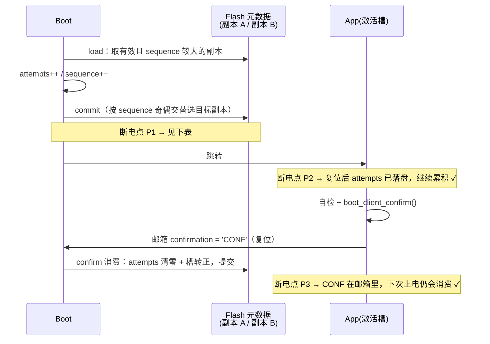

# 🛠️ 04 Bootloader 实现详解

 

> 📚 **系列导航**：[00 规划](00-project-plan.md) · [01 架构](01-architecture.md) · [02 Git](02-git-and-github.md) · [03 风格](03-code-style.md) · [04 实现](04-boot-implementation.md) · [05 对标](05-bootloader-landscape.md)

> [!NOTE]
> 本文档记录**当前已交付代码**（v0.1.0 → v0.2.0-dev，含 v0.4.0 的 X-01 镜像验签）的实现决策与难点，与 [01-architecture.md](01-architecture.md) 的分工是：架构文档回答"应该怎么做"，本文档回答"**实际怎么做的、为什么、哪里是妥协**"。代码位于 `Keil_OTA_Boot/`（Keil MDK-ARM + AC5 工程），应用工程为 `Keil_App/`。v0.1.0 的 BKP 通信决策作为历史记录保留在 §1.4。

## 📋 0. 交付范围与代码地图

v0.2.0-dev 展开的工作（跳转闭环、Flash 分区对称化、跨复位通信（SRAM 邮箱）、元数据双副本、寄存器级 Flash 驱动）后续均已继续推进。**以下为当前实现**：完整的 UART + YMODEM 接收链路已串联——Boot 侧 `Boot/Protocol/boot_update.c` + `boot_cli.c` 搭配 `Common/ota/ota_ymodem.c`，App 侧 `app_ota_service` / `app_transport`；硬件无关模块集中到 `Common/ota/`，由两侧工程各自编译共享。v0.4.0 的 X-01 镜像验签已落地——`Boot/Crypto/` 引入 `boot_verify` 验签封装与 `boot_pubkey` 内置公钥（vendored Monocypher），镜像头升至 v2，上位机负责签名与传签（§8）。v0.1.0 起的历史决策（BKP → SRAM 邮箱迁移等）作为存档保留在 §1.4。

```text
Keil_OTA_Boot/Boot/                        Bootloader 侧模块
├── Config/
│   ├── boot_conf.h                       分区表 / 邮箱与元数据地址 / 魔数 / 超时参数（唯一布局真相）
│   └── boot_types.h                      启动决策与状态快照类型（boot_decision_t / boot_status_t）
├── Core/
│   ├── Src/boot_main.c                   启动流程：确认消费 → 决策 → 跳转 / 升级模式
│   ├── Src/boot_jump.c                   向量表校验 + 环境剥离 + 跳转
│   ├── Inc/boot_main.h
│   └── Inc/boot_jump.h
├── Storage/
│   ├── Src/boot_flash.c                  寄存器级 Flash 擦写（有界轮询）+ 写范围守卫
│   ├── Src/boot_image.c                  槽内镜像校验（头 + 载荷 CRC32 + 向量表）
│   ├── Src/boot_metadata.c               元数据双副本 load / save
│   ├── Src/boot_nvs.c                    参数数据区（NVS）读写
│   ├── Src/boot_slot_writer.c            槽写入会话（擦除 / 顺序追加 / 边收边算 CRC32）
│   ├── Src/boot_adopt.c                  给"Keil 直接烧录、无长度信息"的槽补镜像头并提交 pending
│   └── Inc/...                           上述模块的头文件
├── Protocol/
│   ├── Src/boot_update.c                 OTA 接收会话状态机（握手 → 收包 → 收尾）
│   ├── Src/boot_transport.c              Boot 侧串口传输（RX 中断+环形缓冲，TX 阻塞）
│   ├── Src/boot_cli.c                    命令行命令集
│   └── Inc/...
├── Crypto/
│   ├── Src/boot_verify.c                 槽内镜像 Ed25519 验签（SHA-512 流式摘要 + 逐块读 Flash）
│   ├── Src/boot_pubkey.c                 内置公钥表（编号 1，出厂为占位全 0 须替换）
│   ├── monocypher/                       vendored Monocypher（CC0），仅 ed25519/SHA-512 子集进镜像
│   └── Inc/...
└── Mailbox/
    ├── Src/boot_mailbox.c                .noinit SRAM 跨复位邮箱（magic + CRC32 校验）
    └── Inc/boot_mailbox.h

Common/ota/                                Boot 与 App 共享的硬件无关模块
├── ota_ymodem.c/.h                        YMODEM 组帧（128/1024 字节包 + CRC16）
├── ota_cli.c/.h                           命令行框架
├── ota_crc32.c/.h                         CRC32
├── ota_image.c/.h                         镜像头结构、填充与校验（ota_image_header_t）
└── ota_request.c/.h                       NVS 升级请求记录

Keil_App/App/                              App 侧模块
├── Config/app_config.h                    App 侧布局常量（与 boot_conf.h 逐字节对齐）
├── Platform/Src/app_flash.c               App 侧 Flash 读写
├── Platform/Src/app_transport.c           App 侧串口传输
├── Services/Src/app_ota_service.c         App 侧 YMODEM 升级编排
├── Services/Src/app_nvs.c                 App 侧 NVS 读写
├── Services/Src/app_slot_writer.c         槽写入会话
├── Services/Src/app_cli.c                 命令行命令集
└── BootClient/Src/app_boot_client.c       确认 / 请求升级（自检通过后写邮箱）
```

v0.1.0 交付时下列三项尚未实现，随 v0.2.0-dev 的推进**均已落地**（对应架构文档铁律 R-1"允许写死、允许代码丑"）：

- **输出通道**：Boot 侧 `boot_transport.c` + `boot_cli.c` 提供串口收发与命令行，不再是"仅 CubeMX 配置、无收发逻辑"
- **固件校验**：`boot_image_check()` 已接入完整校验链（头自洽 + 载荷 CRC32 + 向量表首两项），不再是"仅 SP/PC 范围检查"
- **接收链路**：`boot_update.c` 的 YMODEM 三段式状态机已串联，不再是"未动工"

## 📮 1. 跨复位通信：`.noinit` SRAM 邮箱

### 1.1 载体演进与对比

Boot 与 App 之间需要一条"软件复位后还在"的通信信道（请求升级 / 确认 / 计数）。候选载体对比：

| 载体 | 软件复位保持 | 掉电保持 | 容量 | 完整性校验 | 结论 |
|---|:---:|:---:|---|---|---|
| 普通 SRAM（.data/.bss） | ✗ 启动代码清零/重拷 | ✗ | — | — | 不可用 |
| **`.noinit` SRAM 邮箱** | ✓ 链接器不触碰 | ✗ | 32 字节 | magic + CRC32 | **v0.2.0 选择** |
| RTC 备份寄存器（BKP） | ✓ | ⚠️ 仅接 VBAT | 20×4 字节 | 仅逐寄存器魔数 | v0.1.0 曾用，已弃（§1.4） |
| Flash 元数据区 | ✓ | ✓ | 32 KB | 记录级 CRC32 | 持久状态的正解（v0.2.0 已引入，见 §3） |

从 BKP 迁到 SRAM 邮箱的动机：**BKP 逐寄存器独立、没有整体完整性语义**——写者崩溃在"写完字段、还没写完魔数"的中间态时，读方无法察觉；且 20 个寄存器的容量上限决定了协议扩展空间。SRAM 邮箱把 8 个 32 位字段打包为一条记录，用 magic + CRC32 做**整箱校验**，写者崩溃的任何中间态都会导致 CRC 失配 → 整箱作废重置——失败模式是"丢失一次请求、回到安全态"，而不是"执行一个半成品指令"。

### 1.2 邮箱结构（`boot_mailbox.c`）

位于 SRAM 末尾 32 字节 `0x2001FFE0`（`BOOT_MAILBOX_ADDR`），两侧链接脚本（`Keil_OTA_Boot.sct` / `Keil_App_Slot_A.sct`）把 RW_IRAM2 收窄到 `0x3FE0`，**链接器保证不会把这 32 字节分配给普通变量**：

| 字段 | 偏移 | 用途 |
|---|:---:|---|
| `magic` | +0 | `'BOOT'` = `BOOT_MAILBOX_MAGIC`，整箱有效的前提 |
| `request` | +4 | App 写 `'REQB'` 请求进入 Bootloader（F-03） |
| `confirmation` | +8 | App 写 `'CONF'` 确认固件健康（F-15） |
| `attempts` | +12 | Boot 写入：本次启动是第几次试运行（与 `launched_slot`/`launch_flags` 同批发布） |
| `heartbeat` | +16 | App 写入：存活计数，仅调试观察 |
| `launched_slot` | +20 | Boot 写入：本次实际启动的槽 |
| `launch_flags` | +24 | Boot 写入：`BOOT_MAILBOX_FLAG_PENDING` 表示试运行启动 |
| `crc32` | +28 | 前 28 字节的 CRC32 |

写入协议（`boot_mailbox_commit()`）：先改字段，再补 `magic` 并重算 `crc32`，最后 `__DSB()`——**顺序不可换**。读方（`boot_mailbox_is_valid()`）在 magic 与 CRC 双双匹配时保留邮箱内容，否则整箱清零重建。

> [!IMPORTANT]
> **掉电边界**：邮箱只在软件复位（`NVIC_SystemReset()`）后存活，掉电后是随机值——magic/CRC 双重校验保证随机值撞上合法魔数且 CRC 通过的概率是 2⁻⁶⁴ 量级，实际不可能，所以掉电后必然走"作废重建"路径。这是**特性而非缺陷**：掉电不该计为"启动失败"，attempts 类状态本就该断电归零（v0.2 已进一步把主计数搬进元数据，原因见 §3）。

### 1.3 双计数载体：为什么 attempts 的主战场在元数据

v0.1 的连续启动计数放 BKP，v0.2 起主计数走 `metadata.boot_attempts`（Flash 双副本，§3），邮箱的 `attempts` 字段与 `boot_mailbox_attempts()` 读取接口保留但当前无人调用。迁移原因：计数必须**先于跳转提交**（架构文档 §7.4），而"提交"要对掉电也成立——SRAM 邮箱掉电即失，若计数只在邮箱，一次掉电就绕过 F-04 回滚保护。Flash 元数据的双副本写入天然满足"掉电任意时刻至少一份有效"（§3.2）。

### 1.4 历史：v0.1.0 为什么曾选 BKP

v0.1.0 没有 Flash 元数据区，候选只有"零成本复位保持"的载体，BKP 三条理由：备份域只受备份域复位影响（系统复位不清零）；单条 STR 写入零成本；上电初值固定为 0，与魔数比较即可判有效，无需 CRC 协议。使能序列三步（PWR 时钟 → `HAL_PWR_EnableBkUpAccess` → RTC 时钟）漏任何一步都会静默失效，排障记录从略。**迁移决策见 §1.1**——BKP 的逐寄存器无整体校验是硬伤，保留此节仅作决策链完整性的存档。

## 🚀 2. 跳转：boot_jump_vector / boot_jump_to 逐项讲透

### 2.1 校验：四道关，缺一不可

业界三档做法：

| 档位 | 校验内容 | 适用阶段 |
|---|---|---|
| 教程档 | SP/PC 范围检查 | 固件由 SWD 直接烧入，无传输误码 |
| 工程档 | 固件头 + CRC32/SHA256 | 固件经过有误码可能的传输链路 |
| 商用档 | 数字签名（Ed25519/ECDSA）+ 防回滚 | 对抗恶意构造的固件 |

v0.1.0 曾处在第一档，**不是偷懒而是逻辑必然**：固件由调试器完整写入，链路无损，CRC 校验的只是自己刚烧进去的东西——保护力为零。v0.2.0 引入 YMODEM 传输后误码成为真实风险，本实现随之进入**第二档**；v0.4.0 的 X-01 落地后，进槽/启动的镜像还须通过内建公钥的 Ed25519 验签，即踏入**第三档**的"签名"部分（防回滚 X-02 待做，见 §8）。

`boot_image_check()` 把"某个槽能不能启动"收敛成唯一判据，启动决策与 `ota recv` 收尾共用它，避免两处各写一套判据后慢慢分歧。四道关全部通过才是 `BOOT_IMAGE_VALID`：

1. **镜像头自洽**——槽首 0x200 头区的魔术、版本、几何与头 CRC32 全部本地重算，不匹配为 `BOOT_IMAGE_HEADER_INVALID`；
2. **载荷 CRC32 与头声明一致**——重算整槽载荷的 CRC32 与头里的 `payload_crc32` 比对，这是"槽里这堆字节就是当初那一份"的真正证明；
3. **向量表 SP/PC 合法**（`boot_image_vector_valid()`，跳转前最后一道闸门）——即使前两关都过，SP 指向天上或 PC 落在槽外，跳过去也会立刻跑飞：
   - `SP == 0xFFFFFFFF` → 槽为空（擦除态），拒跳；
   - `SP` 不在 `[0x20000000, 0x20020000)` → 初始栈指针指向非 SRAM，第一次压栈即 HardFault；
   - `PC` 不落在本槽载荷区间内（或非 Thumb 地址）→ 入口不在本槽，说明槽内容不是合法向量表。
4. **Ed25519 验签**（`boot_verify_image()`，"这堆字节出自持有私钥的签名机吗"）——`BOOT_REQUIRE_SIGNATURE=1` 时，未签名、算法不符或公钥未知一律拒绝；开发期置 0 时跳过。详见 §8。

> [!NOTE]
> 第三档的"防回滚"（X-02，拒绝低版本降级）尚未实现；签名本身已随 v0.4.0 X-01 落地，因此当前实现处于第三档的签名档位。

> [!TIP]
> VTOR 对齐约束是隐性前提：Cortex-M4 的 `SCB->VTOR` 只保留高 25 位（`SCB_VTOR_TBLOFF_Msk` 截断低 7 位），向量表至少要求 **128 字节对齐**；本工程因槽首 0x200（512 字节）镜像头区落在向量表之前，实际按 **512 字节对齐**（App 链接在 `slot_base + 0x200`）。将来调整槽布局时，`slot_base + 0x200` 不是 128 字节的整数倍会导致向量表重定位异常。

### 2.2 剥离清单：每一步不做的后果

对照 [01-architecture.md](01-architecture.md) §8.2 的清单，逐项给出"为什么"（行号对应 `boot_jump.c`）：

| # | 动作 | 代码 | 不做的后果 |
|---|---|---|---|
| 1 | `__disable_irq()` | L54 | 剥离过程中断进来用旧向量表 + 快要换的旧栈 |
| 2 | 清 NVIC **ICER + ICPR** | L56-59 | ICER 只关使能；**ICPR 不清则 pending 位还在**，App 一开中断立刻补枪 |
| 3 | 停 SysTick（`CTRL / LOAD / VAL` 三写零） | L61-63 | App 重新 `HAL_Init()` 前每 1 ms 一次中断打到旧向量表 |
| 4 | `SCB->VTOR = 槽首 + 镜像头偏移` + `__DSB()/__ISB()` | L66-68 | 异常继续进 Boot 的向量表（Boot 已"不在"了） |
| 5 | `__set_CONTROL(0u)` | L70 | 从 Handler 模式退回 Thread + 特权级、SPSEL 复位到 MSP |
| 6 | `__set_MSP()` + `__DSB()/__ISB()` | L71-73 | 栈还停在 Boot 的栈上，App 一压栈就写坏 Boot 的数据 |
| 7 | 函数指针跳转 | L75 | — |

> [!WARNING]
> **剥离清单当前不含"停 TIM2"**——两侧 TIM2 均已由 CubeMX 初始化（500 Hz 预分频）但尚未启动、未开中断，此刻无风险。v0.2.0 接入升级超时（TIM2 中断）后，**必须在此清单补"停 TIM2 + 清其 NVIC pending"**，否则跳转后 TIM2 中断打进 App 向量表，App 未定义 `TIM2_IRQHandler` 即跑飞。这是接入传输层时最容易漏的一步。

**第 3 步的坑**：`NVIC->ICER[i] = 0xFFFFFFFF` 只是"关闸"，`ICPR` 里挂着的 pending 请求还在排队。App 启动后第一次 `__enable_irq()`（或它使能任何中断）时，这些积压请求会立刻触发——此时 VTOR 已指向 App，但 App 的外设初始化还没做，处理函数面对的是不存在的硬件状态。清 ICPR 是唯一正确姿势。

> [!WARNING]
> **本清单比 [01-architecture.md](01-architecture.md) §8.2 少两项**，是当前实现与架构文档之间的已知偏离，接入 App 时必须核对：
> - **未清 `FPU->FPCCR` 的 ASPEN/LSPEN**（lazy stacking）：Boot 跳转全程不使用浮点、不响应中断，因此不会真的建立 lazy-stacking 状态，本次跳转无实际风险；
> - **未恢复 `PRIMASK`**：第 1 步 `__disable_irq()` 置位后没有对应的 `__enable_irq()`。PRIMASK 是 CPU 级状态，**不会被 `__set_MSP()` 或 App 的启动代码自动清除**，只有 `__enable_irq()` 或复位能清；不恢复则 App 一切中断永远不响应（HAL_Delay 死等是第一症状）。当前由 App 侧在启动早期自行使能中断来兜底——接入 App 时**必须在目标板上确认这一行为**（见 §4）。

### 2.3 与架构文档的分歧：C 函数指针 vs 汇编

[01-architecture.md](01-architecture.md) §8.2 要求跳转用一小段汇编（`msr msp` + `bx`）。**实际实现用了 C 函数指针**（L75），这是一处有记录的偏离：

```c
__set_MSP(sp);                  /* 换栈                          */
((void (*)(void))pc)();         /* 跳转，等效于 BX pc           */
```

成立的前提（AC5 / ARM Compiler 5.06 下的实测代码生成行为）：

1. `pc` 在寄存器里（此前无栈访问），函数指针调用编译为 `BX reg`，不压栈、不触旧栈；
2. `__set_MSP()` 内联为单条 `MSR`，其后到跳转之间没有任何栈访问。

> [!WARNING]
> 这是**靠编译器行为**的省事写法。换编译器（AC6 / GCC / IAR）或提高优化等级时，编译器有权在 `MSR` 之后插入栈操作（例如函数序言的压栈被延迟调度），届时将出现无法调试的间歇性崩溃。**迁移工具链时此处必须改回架构文档规定的汇编版本**，这是本仓库的已知技术债（§7 妥协 #1）。

### 2.4 网上教程三处高频错误对照

排查全网 bootloader 教程时反复出现的三处错误，以及本实现的处理：

| 高频错误 | 症状 | 本实现 |
|---|---|---|
| 只清 ICER 不清 ICPR | App 开中断瞬间被积压请求打断 | L56-59 双写 |
| 不清 `FPU->FPCCR` 的 lazy stacking | 随机位置 HardFault，"能跑几百 ms 然后死" | 当前未清，见 §2.2 的偏离说明 |
| 换栈前不恢复 `PRIMASK` | App 中断全部失灵，HAL_Delay 死等 | 当前未恢复，见 §2.2 的偏离说明 |

## ⚡ 3. 计数先于跳转提交：掉电窗口分析

[01-architecture.md](01-architecture.md) §7.4 要求 `boot_attempts++` 必须发生在跳转**之前**。v0.2 起计数提交在 Flash 元数据（`boot_metadata_save`），不再是 v0.1 那种单条 STR 原子写——提交被展开为"擦除目标副本 → 写入 → 回读校验"三步，用断电点枚举法验证每个窗口：



| 断电点 | 位置 | 复位后状态 | 结果 |
|---|---|---|---|
| P1a | commit 擦除目标副本后、写入前 | 另一副本（sequence 旧 1）有效 | **本次 ++ 丢失**，计数停在旧值——偏松方向：多给 App 一次机会，不会误拒跳 ✓ |
| P1b | commit 写入后（回读校验前后均同） | 新副本有效且 sequence 更大 | 计数已生效 ✓ |
| P2 | 跳转后 App 崩溃、未确认 | attempts 已落盘 | 累积到 `BOOT_MAX_ATTEMPTS` 触发拒跳 ✓ |
| P3 | App 已写 'CONF'、Boot 未消费 | CONF 在 SRAM 邮箱存活（软件复位） | 下次消费并清零 ✓ |
| App 反复崩溃 | 每周期都是 P2 | attempts 累积到 3 | 拒跳，停留升级模式 ✓ |

不变式"**任意时刻断电，下次上电必然回到一个可启动的状态**"在每个断点都成立。P1a 是唯一丢计数的窗口，且失败方向是安全的（多试一次而非误回滚）。

### 3.1 代价：每次启动一次 sector 擦写

`PREPARE_BOOT` 每次都 commit 元数据 = 轮流擦写 sector 2/3（各 16 KB，标称 1 万次擦写周期）。两副本交替承担，等效 2 万次启动余量——开发期每天重启上百次也够用数年，**量产前需要评估**。业界替代（MCUboot 风格）：把 attempts 放在槽尾 trailer 由槽自管理，元数据只在切换事件时提交；本项目 v0.3 引入掉电注入测试时一并权衡。

### 3.2 双副本为什么能兜底

commit 按 `sequence` 奇偶交替选目标（偶写 A、奇写 B），load 取"有效且 sequence 较大"者。两份副本各占一个独立 sector（2/3），擦除其中一份永远不会波及另一份（F4 擦除单元是整个 sector，这是分区表为元数据划出两个 sector 的原因，见 [01-architecture.md](01-architecture.md) §5.2 推导 1）。于是"擦除目标 → 写入"的任意中间态掉电，另一份完整副本始终可加载。

## 🤝 4. App 侧集成约定（`Keil_App/App/BootClient/`）

> [!NOTE]
> 应用侧由独立工程 `Keil_App/` 承担，跨复位通信实现在 `App/BootClient/`（`app_boot_client.c/.h`）。它只读写 SRAM2 顶部那份邮箱，**不碰元数据**：元数据的读写只属于 Boot（`boot_metadata_*`），App 通过置位/读取邮箱字段间接驱动 Boot 的决策。

App 入口的向量表重定位走标准路径，顺序不可换——`app_boot_client_init()` 在 HAL 与外设初始化之后、命令行与升级入口之前调用：

```c
HAL_Init();                     /* ① 时钟 / HAL：SysTick 就位          */
SystemClock_Config();
MX_GPIO_Init();  MX_DMA_Init(); MX_TIM2_Init();
MX_USART1_UART_Init();  MX_USART2_UART_Init();
app_boot_client_init();         /* ② SCB->VTOR = 槽首 + 镜像头偏移     */
app_transport_init();           /* ③ 串口与命令行就绪                   */
```

`app_boot_client_init()` 只是双保险里的一道；`SystemInit()`（`system_stm32f4xx.c`）已经先用 `USER_VECT_TAB_ADDRESS` + `VECT_TAB_OFFSET 0x00020200`（Slot B 为 `0x00080200`）把 VTOR 设好，见 §4.1。

### 4.1 向量表重定位：SystemInit 与 App 各设一次

两条路径都在，覆盖不同故障面：

- `SystemInit()` 设：从复位解向量到 `main()` 之间的异常就进对的表——这是标准做法，也关闭了"启动代码到 main 之间"的窗口期；
- `app_boot_client_init()` 设：与 Boot 跳转时写入的 `SCB->VTOR` 取值一致，保证 App 即使被**调试器直接从槽首烧入**、绕过 Boot 跳转，也能独立定位向量表。

两处取值都必须是"槽首 + `OTA_IMAGE_LOAD_OFFSET`（=0x200）"，且与 scatter 里的 `LR_IROM1` 基址一致（§5.2）。

### 4.2 confirm 的语义约定

`app_boot_client_confirm()` 的契约：**只在自检通过后调用**。`Keil_App` 的 `main()` 在时钟、GPIO、串口与命令行都初始化成功之后，若判定本次是试运行启动（`app_boot_client_is_pending()`），则调用 `app_boot_client_confirm_and_reset()`——写邮箱 confirmation 后立即软复位，让 Boot 把 Pending 转正后以普通启动再跑一遍。真实工程应在完成关键外设初始化、业务自检后再确认；confirm 是 App 对"这版固件健康"的签名，乱用会绕过 F-04 回滚保护（见 §3 边界情况）。

> [!IMPORTANT]
> **确认必须配合复位**：只写邮箱不复位的话，中途掉电会把 SRAM2 里的 confirmation 一起丢掉，而 Boot 侧试运行次数已经加过了，反复上电就可能在镜像完全正常的情况下被误判回滚。

## 🧱 5. 工程结构：为什么是两个独立 Keil 工程

### 5.1 双 target 方案的失败（决策记录）

最初尝试单 `.uvprojx` 双 target（`Keil_OTA_Boot` + `fake_app`）共享源码，失败现象极具迷惑性：

- XML 结构层面完全正确（文件分组、FileType、对称性逐项验证通过）；
- 但 UV4 命令行构建 `Keil_OTA_Boot` target 时，**把 fake_app 的全部文件也编译进来**：日志出现 `app_main.c`/`boot_client.c` 编译记录，共享源文件的对象被重命名为 `boot_flag_1.o`、`stm32f4xx_hal_1.o`（"object file renamed to _1"），链接时 203 个 multiply defined 错误；
- 删除 RTE 段手工添加的 targetInfo、删除 uvoptx、清理输出目录均无效；
- 同一文件构建单 target 工程则零错误——结论：**UV4 (MDK 5.38) 对手工构造的双 target 工程存在解析怪癖**，不可依赖。

### 5.2 拆分方案

| 工程 | 链接基址 | 产物 | 源码 |
|---|---|---|---|
| `Keil_OTA_Boot/MDK-ARM/Keil_OTA_Boot.uvprojx` | 0x08000000（sector 0-1） | `Keil_OTA_Boot\*.axf/.hex` | Core + Boot + HAL |
| `Keil_App/MDK-ARM/Keil_App.uvprojx` | 0x08020200（Slot A 槽底 0x08020000，sector 5-7，`Keil_App_Slot_A.sct`） | `Keil_App\*.axf/.hex` | Core + App + HAL |

两个工程分居 `Keil_OTA_Boot/` 与 `Keil_App/` 目录：各自的业务代码互不引用，硬件无关模块集中在 `Common/ota/`（`ota_ymodem` / `ota_cli` / `ota_crc32` / `ota_image` / `ota_request`），由两侧工程各自编译；分区常量 Boot 侧在 `boot_conf.h`、App 侧在 `app_config.h`，数值逐字节对齐，`boot_conf.h` 是唯一事实来源。命令行批编译：

```powershell
E:\Keil5\UV4\UV4.exe -b "Keil_OTA_Boot\MDK-ARM\Keil_OTA_Boot.uvprojx" -j0 -o boot.log
E:\Keil5\UV4\UV4.exe -b "Keil_App\MDK-ARM\Keil_App.uvprojx"           -j0 -o app.log
```

> [!IMPORTANT]
> **烧录时两个工程都必须用默认的 Erase Sectors 模式**（Keil Flash Download 默认值）。Erase Sectors 只擦 hex 内容覆盖的 sector：Boot 烧录只擦 sector 0-1，App 烧录只擦 sector 5-7，互不伤害。若误选 Erase Full Chip，后烧的工程会把先烧的整个抹掉。

### 5.3 引入签名后 Boot 的 32 KB 预算

X-01 落地使 Boot 的 ROM 增量约 15 KB，逼近 32 KB 上限。四条并用把镜像压回预算内：

1. **选择性链接**：`<OneElfS>1` 让未用到的 Monocypher 函数各占独立节区被剔除（§8.5），实际只保留 `crypto_ed25519_check` / `crypto_sha512_*` 链；
2. **启用 microlib**：`Keil_OTA_Boot.uvprojx` 的 `<useUlib>` 置 1。Boot 无 `printf` / `malloc` 依赖，microlib 安全且显著缩小 C 库；
3. **收紧 scatter 预留**：`Keil_OTA_Boot.sct` 里代码区 `LR_IROM1` 由 `0x7800` 放宽到 `0x7C00`，RAM 函数在 Flash 的初值副本段 `LR_RAMCODE` / `ER_RAMCODE` 由 `0x08007800/0x800` 收为 `0x08007C00/0x400`（实际 `BOOT_RAMCODE` 仅 0x218 字节），`RW_IRAM2` 相应改为 `0x2001BC00/0x43E0`，把回收的约 1 KB 让给代码区。Boot 仍完整占满 sector 0-1 的 32 KB。
4. **保持 `-O2` 优化**：target 级 `<Optim>` 必须为 `3`（-O2）。若该值被重置为 `1`（-O0，CubeMX 重新生成工程时会如此），Boot 代码区会膨胀约 7 KB 并触发 L6406E/L6407E，链接失败；`-O3`（`4`）实测 ROM 反而略大于 `-O2`，故选定 `-O2`。

构建验收（`-O2`）：Boot `LR_IROM1` 实测 `0x78A8`（≤ 上限 `0x7C00`）、`LR_RAMCODE` `0x218`（≤ `0x400`），Flash 合计 `0x7AC0`（31424 字节 ≈ 30.7 KB；`Code=26212`、`RO-data=5188`、`RW-data=24`），`0 Error / 0 Warning`；两个 App target（Slot A/B）链接基址仍分别为 `0x08020200` / `0x08080200`，同样 `0 Error / 0 Warning`。

> [!NOTE]
> **RAM 侧的等价硬约束：栈至少要有 4 KB。** 验签链路是本工程栈占用最深处，`armlink --callgraph` 静态分析给出的最大栈深为 **2968 字节**（`boot_image_check → boot_verify_image → crypto_ed25519_check → crypto_eddsa_check_equation → ge_tobytes → fe_invert → invsqrt → fe_sq`）。CubeMX 生成的 `MDK-ARM/startup_stm32f407xx.s` 默认 `Stack_Size EQU 0x400`（1 KB）远不够用：真机一旦真正走进验签就会栈溢出触发 HardFault，表现为主机上送 EOT 后既无 `OK ota=done` 也无 `ERR` 行。现为 `0x1000`（4 KB），余量约 1.1 KB。栈位于 `RW_IRAM1` 顶部（`__initial_sp = 0x20001970`，栈底 `0x20000970`），与 SRAM2 顶部 32 字节邮箱（`0x2001FFE0`）不相交。
>
> 由此得到一个可复用的结论：**Boot 的 ROM 用 `-O2` + scatter 收紧来压，栈则必须按验签链路的实测值单独放宽**——两者都不是"照 CubeMX 默认值就行"的项。

## 🧪 6. 上板验收手册

### 6.1 烧录与预期现象

**通用规则**：两个工程都用 Keil 的 Flash → Download 通过 SWD 烧录，务必保持默认的 **Erase Sectors** 模式（见 §5.2 的 IMPORTANT）。Boot 烧到 `0x08000000`（只擦 sector 0-1），App 烧到 `0x08020000`（只擦 sector 5-7）。同一块板先烧 Boot，再烧 App。

**开发调试路径（`boot_conf.h` 的 `BOOT_REQUIRE_SIGNATURE = 0`）**

1. Keil 打开 `Keil_OTA_Boot.uvprojx` → Flash → Download；
2. 打开 `Keil_App.uvprojx`，选 target `App_Slot_A` → Flash → Download。App 从 `0x08020200` 起链接，头区 `0x08020000~0x080201FF` 不在镜像内、烧完仍是擦除态——**头区只能由 Boot 写**，这正是直接烧录的 App 需要"补头"的原因；
3. 上电/复位。此时 Flash 里没有任何有效 Metadata（`boot_metadata_defaults()` 的 `active_slot = NONE`），Boot 不会跳任何槽，而是进入升级模式、停在 `boot_wait_update` 死循环。USART2（PD5/PD6，115200 8N1）上出现 CLI 提示，可交互；
4. 在串口终端敲 `ota adopt A 0x00000001`：Boot 扫描 Slot A 的向量表测出镜像大小与 CRC32（头区为擦除态才受理），补写一份未签名镜像头，并把该槽提交为 **pending**（不是 active，仍要过一次试运行）；
5. 再复位一次。Boot 跳 pending 槽试运行 → App 自检通过后写 `CONF` 并自动复位回 Boot → Boot 把 `active` 提交为 Slot A、清零计数。此后每次复位都自动 Boot → App 循环。

> [!NOTE]
> 第 3 步**停在升级模式是预期行为**：没有 Metadata 就没有"该跳哪个槽"的依据。第 5 步现象以 `Keil_App` 为准（`app_boot_client` 已随工程集成，v0.1.0 的 fake_app 演示工程已移除）。

**量产/验收路径（`BOOT_REQUIRE_SIGNATURE = 1`）**

**不能**用直接烧录 + `ota adopt` 让 App 可启动：adopt 在要求签名时返回 `SIGNATURE_REQUIRED`（`boot_adopt.c`），设备侧没有私钥、无法为已烧录的槽补签名。正确做法是走一次正常 OTA：

1. 先 `固件升级上位机.exe --genkey signing.key` 生成密钥对，把公钥填入 `Boot/Crypto/Src/boot_pubkey.c` 后重编译并烧录 Boot（§8.4）；
2. 把私钥 `signing.key` 放到上位机可执行文件同目录；
3. 上位机连接设备的 **USART2**，选好 App 镜像（`.hex`/`.bin`）+ 填入版本号，发起升级。上位机会先下发 `ota recv 0x<版本>`，Boot 收到后回 `C` 进入 YMODEM，镜像连同 `sig=`/`kid=` 一起写入非活动槽；
4. Boot 收尾验签通过后标记 pending 并复位 → 试运行 → App 自动确认。

### 6.2 调试器观察（Watch 窗口）

调试 Boot 工程，Watch 添加 `s_mailbox`（或观察内存 `0x2001FFE0`——`.noinit` SRAM 邮箱，magic + CRC32 保护，跨软复位存活）：

| 字段 | 复位后 Boot 阶段 | App 运行期间 | 回跳后 |
|---|---|---|---|
| `request` | 0 | 复位前瞬间写入 `'REQB'` | 0（Boot 已消费） |
| `confirmation` | `'CONF'` → 消费清零 | 自检后写 `'CONF'` | 0 |
| `attempts` | 每次启动 +1 | `'CONF'` 消费后清零 | 递增 |
| `heartbeat` | 不动 | 持续递增（App 存活证据） | 停在最后值 |

### 6.3 F-04 拒跳实验

把 `boot_conf.h` 的 `BOOT_MAX_ATTEMPTS` 改为 `0u` 重烧 Boot：Boot 每次上电计数后立即超限，永远拒跳、停在升级模式——验证回滚保护的触发路径，且不需要真的做坏固件。

## 🩹 7. 已知妥协清单

| # | 妥协 | 为什么现在可接受 | 计划收紧 |
|---|---|---|---|
| 1 | 跳转用 C 函数指针而非汇编 | AC5 实测代码生成不触旧栈（§2.3） | 工具链迁移时改汇编（§2.3） |
| 2 | 跳转剥离清单未清 `FPU->FPCCR`、未恢复 `PRIMASK` | 跳转路径不使用浮点、不响应中断；PRIMASK 由 App 侧启动早期自行使能 | 与 App 集成一并核对并补回（§2.2 NOTE） |
| 3 | 每次启动 commit 元数据 = 一次 sector 擦写 | 双副本交替，等效 2 万次启动余量（§3.1） | v0.3 掉电注入测试时权衡槽尾 trailer 方案 |
| 4 | 回滚只能由"坏固件自己复位"驱动 | 决策与计数逻辑已就绪，App 自检失败或收到新固件都会主动复位 | 引入 IWDG：Boot 跳 pending 槽前使能看门狗，死循环/卡死也能驱动计数（v0.3） |
| 5 | `boot_pubkey.c` 里的公钥出厂为占位全 0 | 全 0 不是曲线上的有效点，任何签名都验不过，防止"忘换公钥"被悄悄放过 | 量产前用上位机 `--genkey` 生成密钥对，将公钥填入数组后重编译 Boot（§8.4） |
| 6 | YMODEM 第 0 包改为 1024 字节长帧（STX）承载签名 | `sig=`（128 hex）令牌装不进 128 字节短包；设备侧早已支持 STX，结束包不受影响仍是 SOH/128 | 无（协议固化，见 §8.3） |

## 🔐 8. 镜像验签（Ed25519）

v0.4.0 的 X-01：让不可信固件无法进槽、无法启动。设备侧只做**验签**，公钥固化在 Boot 镜像里，私钥永不离开签名机（PC 上的 `--genkey` 产物），因此 Boot 不具备伪造签名的能力。

### 8.1 被签内容：`SHA-512(prologue ‖ 载荷)`

不是对整段固件直接做 Ed25519（那样签名验签都要先缓存整段），也不是对 CRC32 签名（CRC 不是抗碰撞摘要，攻击者可同时改固件与 CRC 使签名仍成立）。本实现自定义为 **hash-then-sign**：

```text
prologue = 镜像头前 28 字节（magic / hw_id / header_version / header_size /
           load_offset / image_size / payload_crc32 / version）
digest   = SHA-512(prologue ‖ payload)          # 64 字节
签名     = Ed25519_sign(privkey, digest)         # RFC 8032 / SHA-512 变体，64 字节
验签     = Ed25519_check(pubkey, digest, signature) == 0
```

- **prologue 长度 = `offsetof(ota_image_header_t, header_crc32)` = 28 字节**（各字段自然对齐、无填充），常量 `OTA_IMAGE_SIGNED_PREFIX_SIZE` 即由此导出。头里 `header_crc32` 与 `signature` 自身**不参与**哈希，避免自指；`hw_id` 与 `version` 则**一并进入**被签内容，把"目标板"和"版本号"钉进签名。
- **两侧唯一契约**就是这个前缀的字段顺序与长度：Boot 侧取头前 28 字节（`boot_verify.c`），PC 侧按同一顺序小端拼出 28 字节（上位机 `FirmwareSigner.PrologueLength = 28`），逐字节对齐，文档中的"32 字节"是早期笔误，以代码为准。

### 8.2 验签时机与调用点

验签一律在**镜像标记为待启用（`mark_pending`）之前**完成，且有签名要求时绝不退化成 CRC32 放行：

| 调用点 | 位置 | 作用 |
|---|---|---|
| 启动/跳转校验 | `boot_image_check()`（`boot_image.c`） | 每次判断"某槽能否启动"时验签，防调试器直烧的未签名镜像被启动 |
| 接收收尾 | `boot_update.c` FINAL 阶段 | 收满镜像后、提交 pending 前验签，拒绝半途篡改或错误签名的固件 |
| NVS 请求提交 | `boot_nvs.c` | 消费 App 透传的升级请求时，用请求携带的签名验收目标槽 |
| `ota adopt` | `boot_adopt.c` | 要求签名时拒绝 `adopt`（设备无私钥，无法为已烧录槽补签名） |

载荷**不缓存进 RAM**：`boot_verify_image()` 从 `slot_base + OTA_IMAGE_LOAD_OFFSET` 起按 256 字节分块读 Flash，流式喂给 SHA-512（`crypto_sha512_init/update/final`），栈占用与全文扫描次数都可控，适合 Boot 的紧张 RAM。

### 8.3 签名怎么从 PC 传到设备

签名不在镜像体里，而是随 YMODEM **第 0 包**的第二字段传递：第 0 包改为 **1024 字节长帧（STX）**，第二字段形如 `<长度> 0x<版本> sig=<128 hex> kid=<2 hex>`；`sig=` 恰好 128 个十六进制字符，`kid=` 只有随签名一起出现才有意义。设备侧 `ota_ymodem_parse_file_info()` 解析出 `has_signature / sig_algorithm / pubkey_id / signature[64]`，写入镜像头（`ota_image_header_fill()`），并把签名透传给 NVS 请求记录（`ota_request` 扩展出 `sig_algorithm / pubkey_id / signature / record_crc32`）。App 只**透传**，不验签；Boot 侧才是唯一验签点。结束包仍走 SOH/128，不受影响。

### 8.4 密钥生成与公钥烧入（量产必做）

```powershell
# 生成密钥对：seed（hex）写 <path>，公钥（hex）打印并写 <path>.pub
固件升级上位机.exe --genkey signing.key
```

把打印出的公钥按字节填进 `boot_pubkey.c` 的 `boot_pubkey_ed25519[32]`，重编译 Boot。私钥 `signing.key` 只留在签名机/HSM，**不得提交进仓库**；上位机默认从可执行文件同目录的 `signing.key` 读私钥，也可显式指定。开发期若暂不需要签名，把 `boot_conf.h` 的 `BOOT_REQUIRE_SIGNATURE` 置 0 即可跳过验签（并放行 `ota adopt`）。

### 8.5 体积与选择性链接

Monocypher 以源码 vendored 到 `Boot/Crypto/monocypher/`（CC0），配合 AC5 的 `<OneElfS>1`（One ELF Section per Function）只把实际用到的 `ed25519_check` / `sha512_*` 链进镜像：map 的 `Removing` 列表显示 argon2 / x25519 / aead / blake2b / chacha20 / poly1305 / sha512_hmac / eddsa_sign 等 499 个未用节区（约 59.6 KB）被剔除。即便如此 ROM 增量约 15 KB，Boot 的 32 KB 预算吃紧，为此启用 **microlib** 并收紧 scatter 中 RAM 函数区预留，详见 §5.3。

---

相关文档：[00-project-plan.md](00-project-plan.md) · [01-architecture.md](01-architecture.md) · [02-git-and-github.md](02-git-and-github.md) · [03-code-style.md](03-code-style.md)
